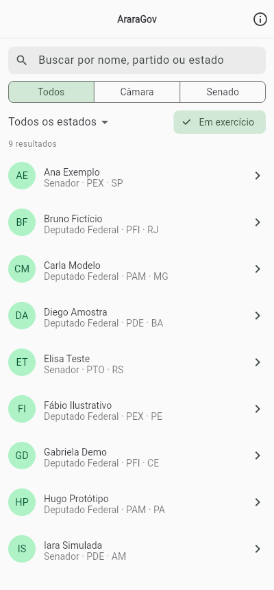
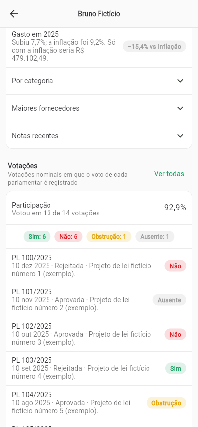
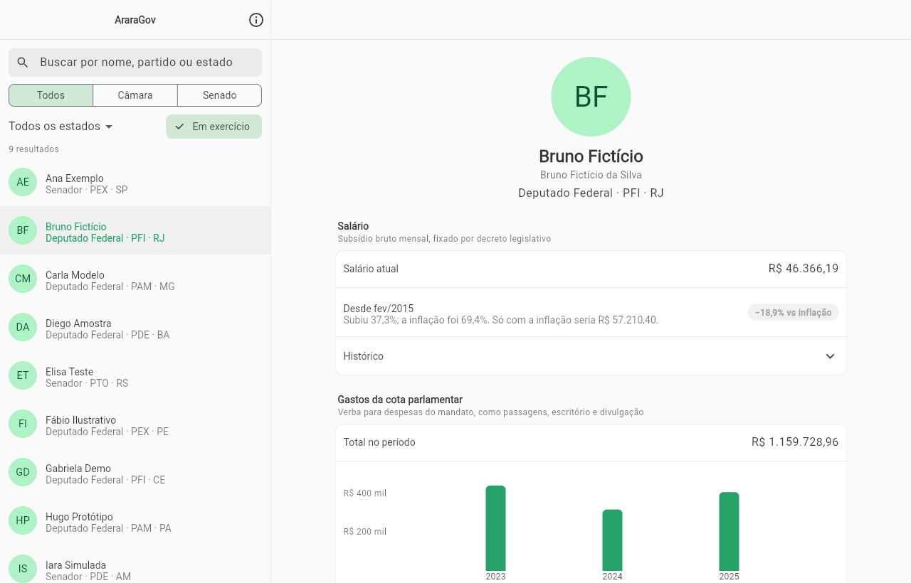

# AraraGov (app)

App em Flutter para iOS, Android, Windows, Linux e macOS. Segue as
[diretrizes de interface do GNOME](https://developer.gnome.org/hig/):
listas em caixa, uma ação principal por tela e detalhes só quando a pessoa
pede (seções que expandem). Em telas largas, lista e perfil ficam lado a lado;
no celular, um de cada vez.

| Busca (celular) | Perfil (celular) | Desktop |
|---|---|---|
|  |  |  |

As capturas usam dados de exemplo com políticos fictícios.

## Dados

O app lê a API estática gerada por `araragov exportar` e publicada no GitHub
Pages (`https://githyot.github.io/AraraGov/v1/`). Para usar outro endereço:

```bash
flutter run --dart-define=ARARAGOV_API=https://exemplo.org/v1
```

Para desenvolver sem internet, com dados fictícios de `assets/amostra`:

```bash
flutter run --dart-define=ARARAGOV_AMOSTRA=true
```

## Pacote para Linux

O workflow `Linux (RPM)` gera o `.rpm`. Uma etiqueta `v*` igual à versão do
`pubspec.yaml` publica o pacote como pré-lançamento. Para instalar:

```bash
sudo dnf install ./AraraGov-linux-x86_64.rpm
```

## Ícone

A cabeça da Arara (mascote do Reelhouse, mesmo criador) no centro da
bandeira do Brasil. Para regerar:

```bash
python3 tool/gerar_icone.py && node tool/rasterizar.js && dart run flutter_launcher_icons
```

## Créditos

As telas e funcionalidades tomaram como modelo o
[Portal Transparência HyperZ](https://github.com/LucDev0001/hyperZ-transparencia)
(GPL-3.0), de LucDev0001.
